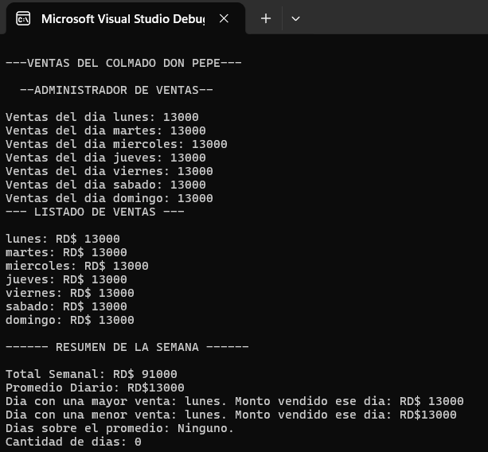
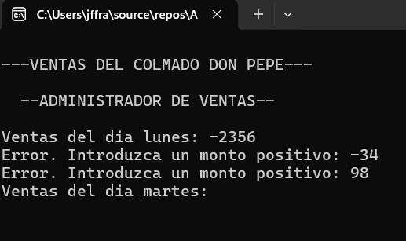
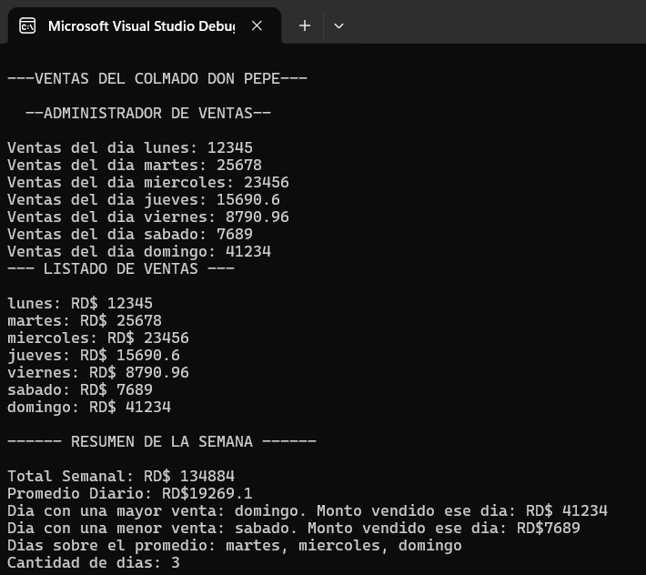

# Programa: Administrador de Ventas del Colmado Don Pepe

## 1. Datos del estudiante

- **Nombre completo:** Jordany Florentino Franco
- **Matrícula:** 2025-2608

## 2. Descripción breve del programa

Este programa en C++ permite registrar y organizar las ventas realizadas durante los siete días de la semana en el Colmado Don Pepe. A partir de los montos introducidos, calcula el total de ventas y el promedio diario. También identifica el día con mayores y menores ventas, y muestra cuáles días estuvieron por encima del promedio semanal, junto con la cantidad de días que cumplen esa condición.

## 3. Datos de entrada

- **Ventas diarias:** Montos de dinero correspondientes a cada uno de los siete días de la semana (lunes a domingo). Los valores deben ser positivos o iguales a cero.

## 4. Datos que procesa

- Almacena las ventas de cada día en un arreglo.
- Comprueba que los montos introducidos no sean negativos. Si se introduce un valor menor que cero, solicita nuevamente el dato.
- Suma las ventas de los siete días para obtener el total semanal.
- Divide el total semanal entre los siete días para calcular el promedio diario.
- Compara las ventas de cada día para identificar cuál tuvo el monto más alto y cuál tuvo el más bajo.
- Revisa cuáles días tuvieron ventas superiores al promedio y lleva la cuenta de ellos.
- Organiza la información para mostrar el listado de ventas y el resumen de la semana.

## 5. Datos de salida

- **Listado de ventas:** Muestra el monto registrado para cada día de la semana.
- **Total semanal:** Presenta la suma de todas las ventas realizadas durante la semana.
- **Promedio diario:** Muestra el promedio de ventas de los siete días.
- **Día con mayor venta:** Indica el día que registró el monto más alto y cuánto se vendió.
- **Día con menor venta:** Indica el día que registró el monto más bajo y cuánto se vendió.
- **Días sobre el promedio:** Muestra los días cuyas ventas superaron el promedio diario.
- **Cantidad de días:** Indica cuántos días estuvieron por encima del promedio.

## Capturas del programa en ejecución

### Prueba 1: Registro de ventas y resumen semanal

### Prueba 2: Validación de montos negativos

### Prueba 3: Días que superaron el promedio

## 6. Estructuras utilizadas y su función

- **Variables de tipo `double`:** Se utilizan para guardar los montos de las ventas, el total semanal y el promedio diario, ya que pueden contener valores decimales.
- **Variables de tipo `int`:** Se utilizan para guardar las posiciones de los días con mayor y menor venta, además de contar cuántos días superaron el promedio.
- **Arreglo `ventas`:** Permite almacenar los montos correspondientes a cada uno de los siete días de la semana.
- **Arreglo `dias`:** Contiene los nombres de los días de la semana para relacionarlos con las ventas registradas.
- **Constante `Dias`:** Establece la cantidad de días que se van a registrar y utilizar durante el programa.
- **Estructura `for`:** Se utiliza para recorrer los arreglos, solicitar las ventas, realizar las comparaciones y mostrar los resultados.
- **Estructura `while`:** Permite validar que el usuario no introduzca montos negativos, solicitando nuevamente el valor cuando sea necesario.
- **Estructura condicional `if`:** Se utiliza para comparar las ventas, identificar los días con mayores y menores montos y determinar cuáles superaron el promedio.
- **Estructura condicional `if` dentro del recorrido:** Permite colocar las comas entre los días que superaron el promedio, evitando que aparezcan al principio o al final de la lista.
- **Estructura condicional `if` final:** Comprueba si ningún día superó el promedio para mostrar el mensaje correspondiente.
- **Acumulador `total`:** Va sumando las ventas introducidas para obtener el total de la semana.
- **Contador `contador`:** Lleva la cuenta de los días que tuvieron ventas superiores al promedio.
- **Librería `iostream`:** Se utiliza para solicitar los datos mediante `cin` y mostrar la información mediante `cout`.
- **Librería `string`:** Permite almacenar los nombres de los días de la semana mediante variables de tipo cadena.
